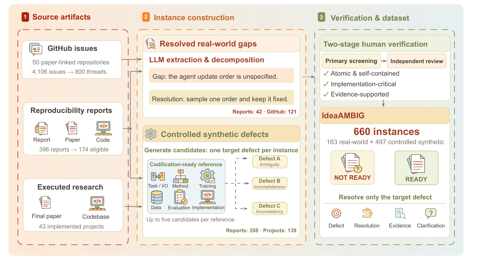

<p align="center">
  
</p>

<h1 align="center">
   Benchmarking Implementation-Critical<br>
  Gaps in Research-Idea Specifications
</h1>

<p align="center">
  <a href="https://arxiv.org/abs/2609.10539">
    
  </a>
  
  <a href="https://github.com/Yiling-Ma/IdeaAMBIG">
    
  </a>
</p>

<p align="center">
  <a href="#overview">Overview</a> &nbsp;&middot;&nbsp;
  <a href="#benchmark">Benchmark</a> &nbsp;&middot;&nbsp;
  <a href="#construction-pipeline">Construction</a> &nbsp;&middot;&nbsp;
  <a href="#results">Results</a> &nbsp;&middot;&nbsp;
  <a href="#quick-start">Quick Start</a> &nbsp;&middot;&nbsp;
  <a href="#citation">Citation</a>
</p>

<p align="center">
  
</p>
<p align="center">
  <em><strong>Evidence-grounded construction.</strong> GitHub issues, reproducibility reports, and executed research projects yield 660 verified instances with paired NOT_READY and READY specifications.</em>
</p>

---

## Overview

**IdeaAMBIG** benchmarks **codification readiness**: whether a research-method specification provides enough information for a faithful initial implementation without unsupported assumptions about the core method.

- **660 evidence-grounded instances**: 163 real-world gaps and 497 controlled synthetic gaps.
- **Paired specifications**: each instance includes a `NOT_READY` specification and a `READY` counterpart that resolves only its target defect.
- **Three diagnostic tasks**: readiness assessment, defect localization, and clarification action generation.
- **A shared taxonomy**: 3 defect types and 10 categories across 10 research domains.
- **13 evaluated LLMs**: proprietary and open-weight models, with separate real-world and synthetic results.

**The central finding:** discovering the implementation blocker is harder than formulating a clarification once it is known. The strongest evaluated model reaches **9.6% Macro DRR** on real-world defect localization, versus **80.6% Macro-CAS** when clarification is guided by the annotated blocker.

---

## Benchmark

### Three Evaluation Tasks

| Task | Model input | Expected output | Primary metric |
| --- | --- | --- | --- |
| **1. Readiness Assessment** | One specification, presented independently | `READY` / `NOT_READY` and a rationale | Macro-F1 |
| **2. Defect Localization** | An underspecified specification | The unresolved decision and its Level-1 / Level-2 labels | Macro Defect Recovery Rate (Macro DRR) |
| **3. Clarification Action Generation** | An underspecified specification **and the annotated defect** | A targeted question or evidence-seeking action, with the information needed to resolve the gap | Macro Clarification Action Success Rate (Macro-CAS) |

Macro DRR requires recovery of the target blocker and both taxonomy labels. Macro-CAS requires a relevant action that requests sufficient information and avoids unsupported assumptions. Task 3 evaluates clarification formulation given a known blocker; the end-to-end variant evaluates clarification without this hint.

### Dataset Composition

| Subset | Source | Instances |
| --- | --- | ---: |
| Real-world | GitHub issues | 121 |
| Real-world | Reproducibility reports | 42 |
| **Real-world subtotal** | | **163** |
| Controlled synthetic | Reproducibility reports | 358 |
| Controlled synthetic | Ideation–execution trajectories | 139 |
| **Synthetic subtotal** | | **497** |
| **Total** | | **660** |

Every main-benchmark instance contains one atomic, implementation-critical defect, its supported resolution, and a gold clarification action. See [Data/README.md](Data/README.md) for the JSONL schema and the separate two-defect ablation.

### Defect Taxonomy

| Level-1 type | Level-2 categories |
| --- | --- |
| **Ambiguity** | Ambiguous Definition; Ambiguous Procedure |
| **Incompleteness** | Missing Method Procedure; Missing Model Structure; Missing Data Specification; Missing Configuration Protocol; Missing Evaluation Specification |
| **Inconsistency** | Conflicting Objective; Conflicting Model Design; Conflicting Formal Definition |

---

## Construction Pipeline

Source artifacts provide evidence for resolved real-world gaps or codification-ready references. Real-world instances reconstruct documented gaps; controlled synthetic instances alter exactly one method-defining detail in a ready reference. Primary screening and independent second review retain atomic, self-contained, evidence-supported cases.

| Construction route | Code and documentation |
| --- | --- |
| Real-world gaps from GitHub issues and reproducibility reports | [Real_Route/](Real_Route/README.md) |
| Controlled single-defect construction from reports and executed projects | [Syn_Route/](Syn_Route/README.md) |

---

## Results

### Main Results Across 13 LLMs

<table>
  <thead>
    <tr>
      <th rowspan="2" align="left">Model</th>
      <th colspan="2" align="center">Task 1: Macro-F1 ↑</th>
      <th colspan="2" align="center">Task 2: Macro DRR ↑</th>
      <th colspan="2" align="center">Task 3: Macro-CAS ↑</th>
    </tr>
    <tr>
      <th>Real</th><th>Synth.</th><th>Real</th><th>Synth.</th><th>Real</th><th>Synth.</th>
    </tr>
  </thead>
  <tbody>
    <tr><td colspan="7"><em>Frontier proprietary models</em></td></tr>
    <tr><td>GPT-5.6-Sol</td><td><strong>67.5</strong></td><td><strong>86.4</strong></td><td><strong>9.6</strong></td><td><strong>12.2</strong></td><td><strong>80.6</strong></td><td><strong>96.2</strong></td></tr>
    <tr><td>Claude Sonnet 5</td><td><u>59.3</u></td><td><u>76.2</u></td><td><u>6.8</u></td><td><u>11.4</u></td><td><u>76.8</u></td><td><u>94.5</u></td></tr>
    <tr><td>Gemini 3.1 Pro Preview</td><td>45.8</td><td>67.3</td><td>3.4</td><td>7.6</td><td>68.9</td><td>91.6</td></tr>
    <tr><td>DeepSeek-V3.2</td><td>44.5</td><td>67.2</td><td>5.9</td><td>8.0</td><td>62.9</td><td>93.0</td></tr>
    <tr><td colspan="7"><em>Open-weight reasoning models</em></td></tr>
    <tr><td>Qwen3.5-397B-A17B</td><td>57.5</td><td>55.9</td><td>3.3</td><td>4.6</td><td>72.0</td><td>89.0</td></tr>
    <tr><td>GLM-5.2</td><td>45.1</td><td>65.9</td><td>5.7</td><td>7.0</td><td>63.6</td><td>77.0</td></tr>
    <tr><td>DeepSeek-R1-0528</td><td>44.3</td><td>59.9</td><td>1.8</td><td>2.2</td><td>68.0</td><td>68.5</td></tr>
    <tr><td>Kimi-K3</td><td>32.7</td><td>43.1</td><td>6.6</td><td>8.2</td><td>60.6</td><td>92.5</td></tr>
    <tr><td colspan="7"><em>Open-weight general models</em></td></tr>
    <tr><td>Gemma-4-31B-IT</td><td>47.1</td><td>56.9</td><td>4.7</td><td>7.0</td><td>67.7</td><td>73.0</td></tr>
    <tr><td>Qwen3-8B</td><td>40.1</td><td>48.7</td><td>3.2</td><td>4.6</td><td>53.8</td><td>82.6</td></tr>
    <tr><td>Qwen3-32B</td><td>34.5</td><td>37.0</td><td>3.6</td><td>5.8</td><td>61.9</td><td>76.3</td></tr>
    <tr><td>Qwen3.5-9B</td><td>33.3</td><td>54.3</td><td>5.3</td><td>5.5</td><td>64.6</td><td>81.2</td></tr>
    <tr><td>GPT-OSS-120B</td><td>30.0</td><td>44.4</td><td>2.5</td><td>3.3</td><td>53.4</td><td>65.3</td></tr>
  </tbody>
</table>

<sub><em>All scores are percentages; higher is better. Bold and underline indicate the best and second-best scores. Task 1 uses 100 READY and 100 NOT_READY specifications per subset. Tasks 2 and 3 use all 163 real-world instances and a fixed sample of 200 synthetic instances.</em></sub>

### What Changes When the Blocker Is Given?

With GPT-5.6-Sol on the same 163 real-world instances, providing the annotated blocker raises clarification success by **67.0 percentage points**.

| Metric | End-to-End | Defect-Guided |
| --- | ---: | ---: |
| Macro-CAS ↑ | 13.6 | **80.6** |
| Sufficiency ↑ | 8.6 | **80.4** |
| No-Assumption ↑ | 96.3 | 95.7 |

### Does Resolving the Gap Help Implementation?

In the **oracle clarification study**, supplying the gold resolution raises the READY rate from **14% to 98%** on 50 real-world instances, evaluated by two human annotators blinded to the generation condition. On 20 controlled instances with bounded implementation components, oracle clarification also improves executable code:

| Metric | Direct Generation | Clarification-Assisted |
| --- | ---: | ---: |
| Runnable ↑ | 70.0 | **95.0** |
| All Tests Pass ↑ | 45.0 | **85.0** |
| Target Fidelity ↑ | 30.0 | **90.0** |
| Further Clarification ↓ | 35.0 | **5.0** |

These utility studies supply the gold resolution and measure the benefit of successful clarification under oracle conditions.

---

## Quick Start

### 1. Get the Dataset

```bash
git clone https://github.com/Yiling-Ma/IdeaAMBIG.git
cd IdeaAMBIG
```

Read the released JSONL files with Python 3; no extra packages are needed:

```python
import json
from pathlib import Path

def load_jsonl(path):
    return [json.loads(line) for line in Path(path).read_text().splitlines() if line.strip()]

real = load_jsonl("Data/real_benchmark_instance.jsonl")
synthetic = load_jsonl("Data/syn_benchmark_instance.jsonl")
print(f"Real: {len(real)} | Synthetic: {len(synthetic)}")

case = real[0]
print(case["input"]["underspecified_spec"])
print(case["defects"][0])
print(case["expected_clarification_actions"])
```

### 2. Build a Task 1 Evaluation Pool

This example builds a pool from the real-world release and separates model-visible inputs from gold annotations:

```bash
python3 Evaluation/task1/build_evaluation_pool.py \
  --input Data/real_benchmark_instance.jsonl \
  --output-dir /tmp/ideaambig-task1
```

This creates `evaluation_pool.jsonl`, `evaluation_gold.jsonl`, and `evaluation_manifest.json`. The pool includes all underspecified inputs and deduplicated ready references; the paper's balanced Task 1 evaluation uses 100 specifications per class and subset.

### 3. Run a Model

```bash
python3 -m pip install tqdm
export OPENROUTER_API_KEY="YOUR_API_KEY"
export OPENROUTER_BASE_URL="https://openrouter.ai/api/v1"

python3 Evaluation/task1/run_baselines_openrouter.py \
  --pool /tmp/ideaambig-task1/evaluation_pool.jsonl \
  --gold /tmp/ideaambig-task1/evaluation_gold.jsonl \
  --models openai/gpt-5.6-sol \
  --prompt-version v3 \
  --subset real \
  --workers 4
```

See [Evaluation/README.md](Evaluation/README.md) for per-task runners, judging, scoring, and clarification ablations. Construction routes have their own dependencies and usage instructions.

### Repository Structure

| Path | Contents |
| --- | --- |
| [Data/](Data/README.md) | Released benchmark, schema, and multi-defect ablation data |
| [Real_Route/](Real_Route/README.md) | Real-world construction from GitHub issues and reproducibility reports |
| [Syn_Route/](Syn_Route/README.md) | Controlled synthetic construction from reports and ideation–execution trajectories |
| [Evaluation/](Evaluation/README.md) | Task 1–3 prompting, judging, scoring, and clarification studies |
| [docs/](docs/README.md) | Paper figures used in this README and their source provenance |

---

## Citation

```bibtex
@article{ma2026ideaambig,
  title  = {IdeaAMBIG: Benchmarking Implementation-Critical Gaps in Research-Idea Specifications},
  author = {Ma, Yiling and Zhao, Yilun and Wu, Sihong and Patwardhan, Manasi and Cohan, Arman},
  year   = {2026},
  journal = {arXiv preprint arXiv:2609.10539},
  url    = {https://arxiv.org/abs/2609.10539}
}
```
